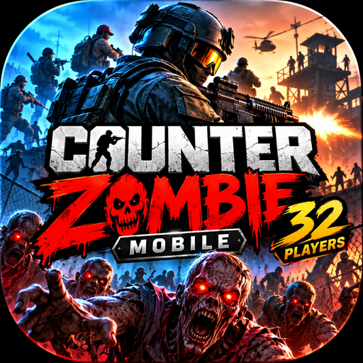

# Counter Zombie Mobile 32 players



Android-игра на основе [CS16Client](https://github.com/Velaron/cs16-client)
и [Xash3D FWGS](https://github.com/FWGS/xash3d-fwgs).
Рабочая ветка: `feature/mobile-launcher`. Исходный `main` сохранён.

## Один APK

Движок Xash3D, SDL, клиент, меню, серверная библиотека и боты собираются из исходников
и работают внутри одного Android-приложения. Отдельные Xash3D и CS16Client не нужны.

Полный тестовый APK включает предоставленный владельцем архив игровых ресурсов.
Первый запуск проверяет и распаковывает данные автоматически, показывает прогресс
и открывает игру. Следующие запуски используют подготовленные данные.
Ручное копирование файлов в `/sdcard/xash` не требуется.

- Название: **Counter Zombie Mobile 32 players**.
- Пакет: `ru.kurostreet.counterzombiemobile` (`.test` у тестовых сборок).
- Одна иконка запуска с нашим логотипом.
- Игровые ресурсы и настройки игрока хранятся раздельно, во внутренней папке приложения.
- Контроль SHA-256, CRC, путей и размера при подготовке ресурсов.
- Список наших серверов и остальные изменения игры — следующие этапы.
- 32 players — утверждённое название; нагрузочные испытания на 32 игрока ещё не проведены.

## Сборка

```sh
git clone --recurse-submodules https://github.com/kurostreet/cs16-client.git
cd cs16-client
git switch feature/mobile-launcher
python3 scripts/prepare_game_bundle.py /path/to/game-cache.zip android/offline-assets
cd android
CZM_GAME_ASSETS_DIR="$PWD/offline-assets" ./gradlew assembleGitDebug
```

Нужны Java 21, Python 3.11+, Ninja, CMake, Android SDK 36 и NDK 28.2.13676358.
Движок закреплён на коммите `51353ff8d65e58300eeb2bd014867673f1f367c6`;
SDL — `98d1f3a45aae568ccd6ed5fec179330f47d4d356` (2.32.8).

[GitHub Actions](https://github.com/kurostreet/cs16-client/actions) собирает
**Core APK** с движком и клиентом, без закрытого архива игровых данных.
Это промежуточный артефакт сборки. Инструкция добавления локального архива:
[STANDALONE_ANDROID_RU.md](docs/STANDALONE_ANDROID_RU.md).

Результат проверки полного APK: [STANDALONE_TEST_2026-10-10.md](docs/STANDALONE_TEST_2026-10-10.md).

## Лицензии и дальнейшая разработка

Исходные лицензии и уведомления авторов сохранены:
[CS16Client](docs/UPSTREAM_README.md), [LICENSE](LICENSE),
[Xash3D FWGS](3rdparty/xash3d-fwgs), [SDL](3rdparty/SDL).
Игровые модели, карты, звуки и текстуры имеют отдельные условия распространения;
для публичного выпуска и Google Play нужны соответствующие права.

План: [MOBILE_LAUNCHER_PLAN_RU.md](docs/MOBILE_LAUNCHER_PLAN_RU.md).
Оформление: [BRANDING_RU.md](docs/BRANDING_RU.md).
Меню и экран загрузки: [LOADING_SCREEN_RU.md](docs/LOADING_SCREEN_RU.md).
Новое главное меню: [MAIN_SCREEN_RU.md](docs/MAIN_SCREEN_RU.md).
